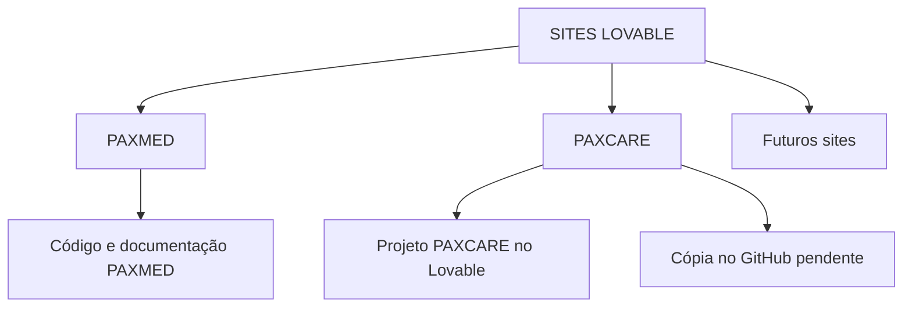

# SITES LOVABLE

Índice central dos sites do ecossistema. Organização em revisão em 27/11/2026.

## PAXMED

- Projeto: [PAXMED no Lovable](https://lovable.dev/projects/eb745d14-e232-4648-83f2-896318deef79).
- Código neste repositório: [src](src/), [public](public/), [docs](docs/), [tests](tests/), [drizzle](drizzle/) e [supabase](supabase/).
- Referência verificada em 27/11/2026: commit `a31a42af153a820277ef2c3d0683f916074bfe96`. O repositório e o Lovable informavam a mesma versão naquele momento; novas alterações podem mudar essa condição.
- O código PAXMED está na raiz. Preserve a estrutura atual até testar qualquer migração e a sincronização com o Lovable.

## PAXCARE

- Projeto: [PAXCARE no Lovable](https://lovable.dev/projects/dea1937b-ef36-4d07-a9ed-bba601c30494).
- Versão observada em 27/11/2026: `88f457e2fbd4775ed96e6e8fe8070744914b1eb3`.
- **Pendente:** incluir e verificar uma cópia completa do código e das imagens no GitHub. Este índice não significa que o código PAXCARE esteja neste repositório.
- A sincronização própria do PAXCARE com o GitHub não foi comprovada. Definir e testar como manter a cópia atualizada antes de tratá-la como automática.

## Próximos sites

Adicionar uma seção para cada projeto com nome, finalidade, projeto Lovable, localização real do código, versão conferida e estado da sincronização.

## Integração com o Manager

O Manager foi observado em https://paxmed.com.br e é separado dos projetos Lovable. Um link entre sistemas não comprova autenticação, envio ou persistência de dados.

## Estado desta organização

Este índice é uma proposta em ramo separado, sem mesclagem com a versão principal. Não representa publicação nos sites. Renomeação do repositório, inclusão completa do PAXCARE, sincronização e validação permanecem pendentes.
