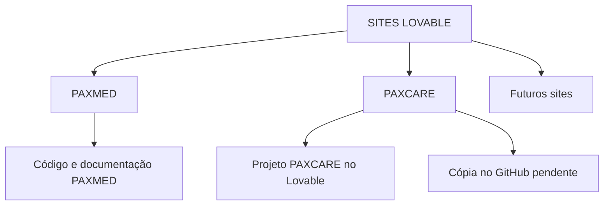

# SITES LOVABLE

Índice central dos sites do ecossistema. Organização em revisão em 27/11/2026.

## PAXMED

- Projeto: [PAXMED no Lovable](https://lovable.dev/projects/eb745d14-e232-4648-83f2-896318deef79).
- Código neste repositório: [src](src/), [public](public/), [docs](docs/), [tests](tests/), [drizzle](drizzle/) e [supabase](supabase/).
- Referência verificada em 27/11/2026: commit `a31a42af153a820277ef2c3d0683f916074bfe96`. O repositório e o Lovable informavam a mesma versão naquele momento; novas alterações podem mudar essa condição.
- O código PAXMED está na raiz. Preserve a estrutura atual até testar qualquer migração e a sincronização com o Lovable.

## PAXCARE

- Projeto: [PAXCARE no Lovable](https://lovable.dev/projects/dea1937b-ef36-4d07-a9ed-bba601c30494).
- Versão observada em 27/11/2026: `88f457e2fbd4775ed96e6e8fe8070744914b1eb3`.
- **Pendente:** incluir e verificar uma cópia completa do código e das imagens no GitHub. Este índice não significa que o código PAXCARE esteja neste repositório.
- A sincronização própria do PAXCARE com o GitHub não foi comprovada. Definir e testar como manter a cópia atualizada antes de tratá-la como automática.

## Próximos sites

Adicionar uma seção para cada projeto com nome, finalidade, projeto Lovable, localização real do código, versão conferida e estado da sincronização.

## Integração com o Manager

O Manager foi observado em https://paxmed.com.br e é separado dos projetos Lovable. Um link entre sistemas não comprova autenticação, envio ou persistência de dados.

## Estado desta organização

Este índice é uma proposta em ramo separado, sem mesclagem com a versão principal. Não representa publicação nos sites. Renomeação do repositório, inclusão completa do PAXCARE, sincronização e validação permanecem pendentes.

## Catálogo completo dos projetos Lovable — 27/11/2026

Este catálogo identifica 17 projetos localizados no workspace Lovable. Os links abrem os projetos originais; um link não constitui uma cópia do código no GitHub. Exceto o PAXMED, a cópia integral e a sincronização neste repositório não foram verificadas. Alguns projetos podem ser sistemas ou versões de experiências anteriores, e não sites institucionais.

| Nº | Projeto | Situação no Lovable | Código neste repositório |
| --- | --- | --- | --- |
| 01 | [PAXMED](https://lovable.dev/projects/eb745d14-e232-4648-83f2-896318deef79) | Publicado | Na raiz; versão observada acima |
| 02 | [PAXCARE](https://lovable.dev/projects/dea1937b-ef36-4d07-a9ed-bba601c30494) | Publicado | Cópia pendente de inclusão e verificação |
| 03 | [Gabriela Severo](https://lovable.dev/projects/5ed950ff-8cd0-403d-8fe8-f58b66365278) | Não publicado | Cópia pendente |
| 04 | [Dr. Caio Padua’s Hub](https://lovable.dev/projects/a8a034f4-7190-4a5b-94ff-9d17cb9411de) | Não publicado | Cópia pendente |
| 05 | [Cícero João: Progresso em Ação](https://lovable.dev/projects/417e5491-c0af-493a-9c30-d9bd35d36c25) | Publicado | Cópia pendente |
| 06 | [CARLUCIA SITE](https://lovable.dev/projects/a182a3a0-93d3-4eef-a341-5fd59152eb81) | Não publicado | Cópia pendente |
| 07 | [Portfolio Compass](https://lovable.dev/projects/94bf9438-e0cf-4d99-9fc8-16f2d6700204) | Não publicado | Cópia pendente |
| 08 | [Patrium Flow](https://lovable.dev/projects/cb901902-a922-42ff-a401-3705fe37a03d) | Não publicado | Cópia pendente |
| 09 | [Core Allocation Matrix](https://lovable.dev/projects/da97aa1b-2446-472d-a744-a085977bf206) | Não publicado | Cópia pendente |
| 10 | [Patrium Command Center](https://lovable.dev/projects/3ab986e7-b531-4235-b23e-056695d63898) | Não publicado | Cópia pendente |
| 11 | [Property Insight](https://lovable.dev/projects/49a434fc-13d8-4235-82da-74b63b33aeb6) | Não publicado | Cópia pendente |
| 12 | [Daiana’s Authority Platform](https://lovable.dev/projects/acc95ac0-0ad9-4f27-9d72-56a03a74abb5) | Publicado | Cópia pendente |
| 13 | [Aurelian Med](https://lovable.dev/projects/d39a2052-dba2-4a32-a880-ec272076d068) | Não publicado | Cópia pendente |
| 14 | [Golden Gateway Entry](https://lovable.dev/projects/08507615-fcbe-446f-93b7-e91d4b7bed40) | Não publicado | Cópia pendente |
| 15 | [PAWARDS Elevated Return](https://lovable.dev/projects/a7eaf90c-4034-42ec-b0cf-0b0a27226cad) | Não publicado | Cópia pendente |
| 16 | [Medcore Gateway](https://lovable.dev/projects/989def3e-50f6-45e0-beb7-68f0b048b34a) | Não publicado | Cópia pendente |
| 17 | [PAWARDS MEDCORE: Nova Lux](https://lovable.dev/projects/4d8fc6f9-75de-44f3-8366-777ea6e725ba) | Não publicado | Cópia pendente |

## Cinco espaços para projetos futuros

| Espaço | Projeto | Situação |
| --- | --- | --- |
| 18 | Futuro site 01 | Reservado |
| 19 | Futuro site 02 | Reservado |
| 20 | Futuro site 03 | Reservado |
| 21 | Futuro site 04 | Reservado |
| 22 | Futuro site 05 | Reservado |

Os espaços são identificações no catálogo; ainda não há projetos ou pastas com código neles.
